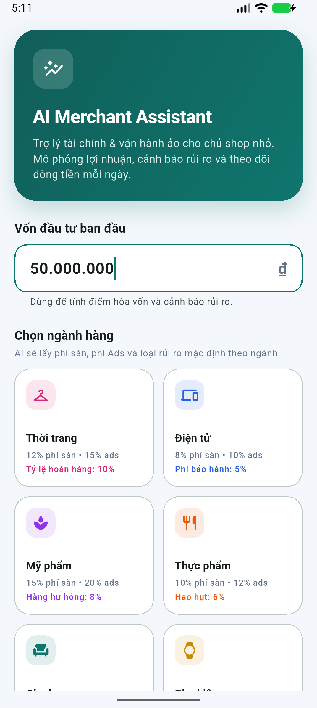
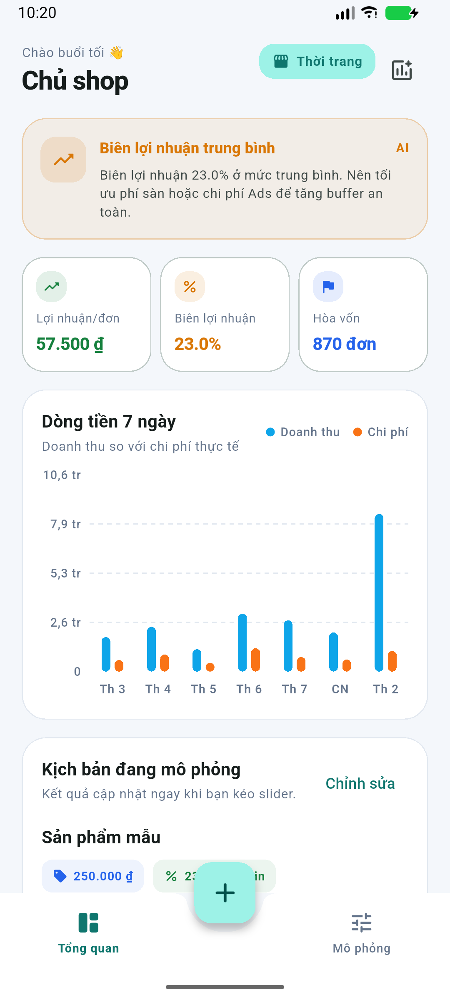
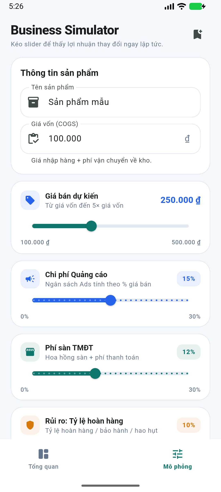
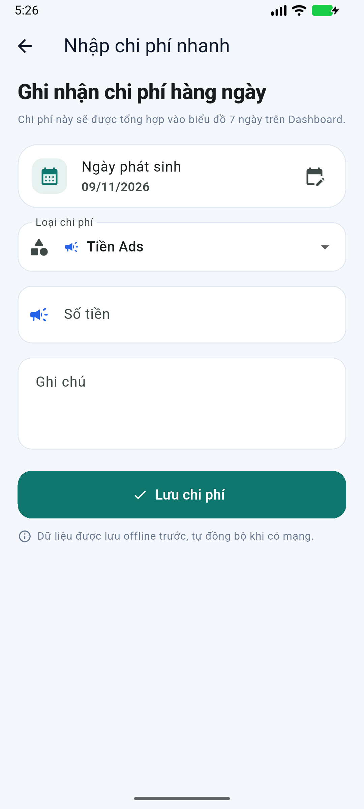
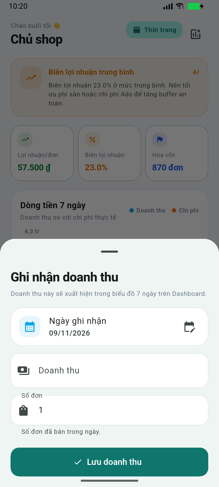

# AI Merchant Assistant

A Flutter (iOS + Android) financial & operations assistant for micro-SMEs and
solopreneurs. It focuses on **progressive disclosure**: large cards, sliders, and
color-coded warnings instead of spreadsheets.

| Onboarding | Executive Dashboard |
| --- | --- |
|  |  |

| Business Simulator | Quick Expense |
| --- | --- |
|  |  |

| Quick revenue entry |
| --- |
|  |

## What is implemented

- **Onboarding**: VND capital input + category grid from `System_Benchmarks`
  (with local seed fallback), saved to `User_Business_Profile`.
- **Business Simulator**: product name, COGS, selling-price slider
  (`COGS … 5×COGS`), Ads %, platform fee %, dynamic industry risk %, and an
  advanced fixed packaging fee.
- **Realtime results**: gross profit/unit, margin %, break-even units, and a
  cost breakdown. Every slider update recalculates instantly via Riverpod.
- **Executive Dashboard**: AI alert bubble (red/amber/green), 7-day revenue vs.
  expense bar chart (`fl_chart`), KPI cards, current scenario, recent expenses.
- **Quick Expense Tracker**: date picker (today by default), expense type,
  amount in VND, note; writes to local DB and refreshes the dashboard chart.
- **Quick revenue entry**: the dashboard chart action records daily revenue and
  units; the 7-day chart updates immediately.
- **Offline-first storage**: Hive CE boxes; all writes hit local storage first.
- **Optional Supabase cloud**: anonymous session, benchmark pull, and
  fire-and-forget upserts for profile, products, expenses, and sales.
- **Sync on app start/resume** and after each local write.

## Tech stack

| Concern | Choice |
| --- | --- |
| Framework | Flutter 3.47.9 / Dart 3.13.7 |
| State | `flutter_riverpod` 3.5.0 |
| Charts | `fl_chart` 1.3.0 |
| Local DB | `hive_ce` 2.23.2 + `hive_ce_flutter` 2.5.0 |
| Cloud | `supabase_flutter` 2.18.3 (optional) |
| Currency / dates | `intl` 0.20.3 |
| IDs | `uuid` 4.6.0 |

### Why Hive CE instead of Isar?

The PRD allows **Isar or Hive**. Isar 3.x is effectively unmaintained and its
codegen/analyzer stack is not compatible with Dart 3.13 without pinning old
packages. Hive CE is maintained, pure Dart, needs no native build step, and gives
the same synchronous, 0ms local reads required by the offline-first design.

The `LocalStore` interface isolates the choice: swapping to Isar later only
requires a new `LocalStore` implementation, not UI changes.

## Run

```bash
cd ~/Desktop/ai_merchant_assistant
flutter pub get
flutter run
```

APKs:

```text
build/app/outputs/flutter-apk/app-debug.apk    # 194 MB, debug
build/app/outputs/flutter-apk/app-release.apk  # 59 MB, debug-signed for local install
```

The release APK currently uses the template's debug signing config. Configure a
real keystore before publishing to a store.

The app runs **100% local** by default. No Supabase configuration is required.

## Optional Supabase setup

1. Create a Supabase project.
2. Run [`supabase/schema.sql`](supabase/schema.sql) in the SQL editor.
3. Enable **Anonymous sign-ins** in Authentication → Providers (the app uses an
   anonymous session as the minimal Auth integration).
4. Run with credentials:

```bash
flutter run \
  --dart-define=SUPABASE_URL=https://YOUR_PROJECT.supabase.co \
  --dart-define=SUPABASE_ANON_KEY=YOUR_ANON_KEY
```

Without the `--dart-define` values, `SupabaseBootstrap` skips initialization and
`SyncService` becomes a no-op. The local app remains fully functional.

## Project structure

```text
lib/
  main.dart                     Hive + Supabase bootstrap, ProviderScope overrides
  app.dart                      MaterialApp, Vietnamese localization, auth gate
  core/
    constants/app_constants.dart
    theme/app_theme.dart        Material 3 fintech theme
    utils/currency_formatter.dart
    utils/category_visuals.dart
    utils/expense_visuals.dart
    widgets/metric_card.dart
  data/
    models/                     SystemBenchmark, UserBusinessProfile,
                                ProductSimulation, DailyExpense, DailySale
    local/
      local_store.dart          Storage contract
      hive_local_store.dart     Hive CE implementation + seeding
      seed_data.dart            Benchmarks + debug demo rows
    remote/
      supabase_config.dart
      supabase_bootstrap.dart
      benchmark_remote_data_source.dart
      sync_service.dart
    repositories/               Profile, product, expense, benchmark
  features/
    onboarding/presentation/
    simulator/
      domain/                   FinancialCalculator + SimulationState
      presentation/             Screen + Riverpod notifier
    dashboard/
      domain/                   DashboardData + aggregation repository
      presentation/             Screen + AI alert + chart
    expenses/presentation/
    sales/presentation/         Quick revenue bottom sheet
    shell/presentation/         Bottom nav + center FAB
  providers/app_providers.dart  Riverpod composition root
test/
  financial_calculator_test.dart
  models_test.dart
  simulator_state_test.dart
supabase/schema.sql
docs/ARCHITECTURE.md
```

## Financial model

All values are per unit and in VND:

```text
Cost = COGS
     + Selling_Price * platform_fee
     + Selling_Price * ads_rate
     + Selling_Price * risk_rate
     + packaging_fee

Gross_Profit = Selling_Price - Cost
Margin       = Gross_Profit / Selling_Price * 100
Break_Even   = ceil(initial_capital / Gross_Profit)   if Gross_Profit > 0
             = null                                   otherwise ("Lỗ vốn")
```

Example (default simulator):

```text
COGS 100,000 · Selling 250,000 · Ads 15% · Platform 12% · Risk 10%
Cost   = 100,000 + 30,000 + 37,500 + 25,000 = 192,500
Profit = 57,500 / unit
Margin = 23.0%
Capital 50,000,000 → break-even = ceil(50,000,000 / 57,500) = 870 units
```

The calculator also guards zero selling price (no NaN) and clamps percentages
to `0..1`. Unit tests assert the exact formula.

## Realtime state flow

```text
Slider onChanged
  → SimulatorNotifier updates SimulationState
    → simulatorResultProvider recalculates FinancialCalculator
      → MetricCard / AI alert / dashboard rebuild
```

`simulatorProvider` watches the selected benchmark and profile, so choosing a
category applies its default platform fee, Ads rate, and dynamic risk type.
The selected selling price is always clamped to `COGS … 5×COGS`; changing COGS
clamps the current price automatically.

## Offline-first write path

```text
UI action
  → Repository
    → LocalStore (Hive) write  ← source of truth, instant
      → SyncService upsert to Supabase (fire-and-forget)
        → failures are logged; local row remains intact
```

`SyncService.bootstrap()` runs on app start/resume: anonymous session →
pull `system_benchmarks` → upsert all local rows. For true OS background sync,
wire the same `SyncService` into WorkManager; the seam is already isolated.

## Debug demo data

`HiveLocalStore` seeds 7 days of sample sales/expenses **only in debug builds and
only when the boxes are empty**. This makes the dashboard chart useful on first
run. Release builds start empty until real data exists.

The PRD schema has no sales table, but the dashboard requires revenue. A small
`DailySale` extension (`id, date, revenue, units`) was added; the schema file
includes `daily_sales`. The dashboard's add-chart action records real revenue
through `QuickSaleSheet`, so release builds are not dependent on demo data.

## Verification

```text
flutter analyze                  No issues found
flutter test                     12/12 tests passed
flutter build apk --debug        Built app-debug.apk
```

Emulator flow (Android 17 / API 37):

1. Onboarding with 50,000,000 ₫ and “Thời trang”.
2. Dashboard shows 57,500 ₫/unit, 23.0% margin, 870-unit break-even, and the
   7-day revenue/expense chart.
3. Simulator: dragged selling price to 460,000 ₫ → profit 189,800 ₫,
   margin 41.3%, break-even 2,635 units, without lag.
4. Quick expense: added 500,000 ₫ Ads → dashboard chart updated and snackbar
   confirmed the write.
5. Quick revenue: added 5,000,000 ₫ / 1 order → chart maxY expanded to 10.6 tr
   and the new revenue bar appeared immediately.
6. Force-stop + relaunch: profile, category, expenses, and revenue persisted
   from Hive.

## Limitations / next steps

- `SyncService` is lifecycle-driven; use WorkManager for background execution
  when the app is closed.
- Supabase Auth is anonymous-only in the UI; add email/OTP and a sign-in screen
  for multi-device identity.
- POS integration / bulk sales import (manual quick-sale entry already exists).
- Add product list/edit/delete screens (the data layer already stores
  `ProductSimulation`).
- Add export/backup and encrypted Hive box for production.
